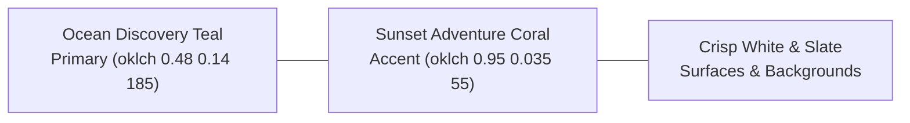

# TripGenie — Design System & Visual Direction (DESIGN.md)

> **Identity**: Nền tảng Lập kế hoạch Du lịch Thông minh & Cộng tác Thời gian thực.  
> **Aesthetic Philosophy**: **Modern Travel Editorial** — Tinh tế, thoáng đãng, mang hơi thở tạp chí du lịch cao cấp; tôn vinh văn hóa và ẩm thực bản địa.  
> **Source of Truth for Visuals**: Được đồng bộ trực tiếp với `frontend/src/app/globals.css` và `frontend/src/app/layout.tsx`.  
> **Governing Filter**: Kết hợp cùng `.agents/skills/antislop-ui/SKILL.md` để loại bỏ 100% "AI Slop".

---

## 1. Dials & Liveliness Settings (Tham số Antislop)

| Tham số | Giá trị | Ý nghĩa thực tế |
|---|---|---|
| **ENERGY** | `2` (Balanced) | Giao diện tươi sáng, khơi gợi cảm hứng xê dịch nhưng giữ được sự trang nhã; không màu mè khoa trương, không dùng màu neon. |
| **RHYTHM** | `2` (Harmonic) | Nhịp điệu bố cục đa dạng: Hero trực quan $\to$ Bảng tra cứu & Bộ lọc $\to$ Thẻ địa điểm $\to$ Timeline lộ trình ngày $\to$ Bản đồ VietMap tương tác. |
| **MOTION** | `1` (Subtle) | Chuyển động nhẹ nhàng (150ms–250ms) cho micro-interactions (hover, active, modal fade-in). Tuyệt đối **không có endless animation loops** (trừ live indicator của hệ thống). |

---

## 2. Brand Identity & Personality

- **Tính cách thương hiệu**: Thấu hiểu, phóng khoáng, tin cậy, giàu chất bản địa.
- **Trải nghiệm cốt lõi**:
  - Không khiến người dùng bị ngợp thông tin: ưu tiên hình ảnh chất lượng cao và khoảng trắng thở (`whitespace as structure`).
  - Mọi thao tác đều mang tính trực quan và chạm tới cảm xúc (như xem một cuốn tạp chí du lịch sống động).
- **Nguyên tắc "The Litmus Test"**:
  > Nếu gỡ bỏ logo TripGenie, giao diện vẫn phải toát lên rõ nét phong cách du lịch Việt Nam hiện đại, không bị nhầm lẫn với bất kỳ dashboard SaaS quản lý công việc chung chung nào.

---

## 3. Color System (OKLCH Semantic Tokens)

Hệ thống màu được chuẩn hóa theo chuẩn OKLCH trong `globals.css` đảm bảo độ tương phản hoàn hảo (WCAG 2.2 AA $\ge 4.5:1$):

### 3.1 Light Mode (Chủ đạo)
- **`--primary`**: `oklch(0.48 0.14 185)` (Ocean Discovery Teal — Xanh ngọc biển sâu). Đại diện cho khám phá, đại dương và sự tin cậy. Dùng cho: Primary CTA, Active Tabs, Map Pins chính, Highlight icons.
- **`--primary-foreground`**: `oklch(0.99 0 0)` (Trắng tinh khiết).
- **`--secondary`**: `oklch(0.95 0.025 185)` (Soft Mist Teal — Xanh sương mai). Dùng cho: Nền badge, Chips chọn nhanh, nút phụ.
- **`--secondary-foreground`**: `oklch(0.35 0.10 185)`.
- **`--accent`**: `oklch(0.95 0.035 55)` / Coral (Sunset Adventure Coral — Cam san hô hoàng hôn). **Màu nhấn duy nhất** cho các khoảnh khắc đặc biệt: Tag ẩm thực đặc sắc, Deal hot, Nút Cố vấn AI nổi bật.
- **`--background`**: `oklch(0.99 0.005 240)` (Nền trắng ánh lam nhẹ, thoáng đãng).
- **`--card`**: `oklch(1 0 0)` (Trắng đặc, làm nổi bật hình ảnh địa điểm).
- **`--muted`**: `oklch(0.96 0.008 240)` & `--muted-foreground`: `oklch(0.48 0.025 240)`.
- **`--border`**: `oklch(0.91 0.01 240)` (Viền xám mảnh tinh tế).

### 3.2 Dark Mode (Hỗ trợ ban đêm)
- **`--background`**: `oklch(0.14 0.02 240)` (Midnight Navy — Xanh đen màn đêm dịu mắt, không dùng màu đen tuyền `#000000`).
- **`--card`**: `oklch(0.18 0.025 240)`.
- **`--primary`**: `oklch(0.68 0.13 185)` (Luminous Teal — Xanh ngọc phát sáng nhẹ, tương phản cao trên nền tối).

---

## 4. Typography Pairing (Hệ Thống Phông Chữ)

Được cấu hình qua `next/font/google` trong `RootLayout`:

| Vai trò | Phông chữ | Class Tailwind | Ứng dụng thực tế |
|---|---|---|---|
| **Heading (Tiêu đề)** | **Playfair Display** | `font-heading font-serif` | Tiêu đề trang, tên địa phương (Đà Nẵng, Phú Quốc), tiêu đề chuyến đi. Tạo cảm giác tạp chí du lịch cao cấp (*Editorial*). |
| **Body (Nội dung)** | **Geist Sans** | `font-sans` | Đoạn văn mô tả, thông số lịch trình, giờ mở cửa, giá vé, ghi chú. Tối ưu độ sắc nét và dễ đọc. |
| **Monospace (Số liệu kỹ thuật)** | **Geist Mono** | `font-mono` | Tọa độ GPS, mã chuyến đi, mã đặt vé tàu xe máy bay. |

### Thang đo tỷ lệ (Scale):
- `text-2xl sm:text-3xl lg:text-4xl font-bold font-heading`: Tiêu đề Hero và Tiêu đề trang.
- `text-lg sm:text-xl font-semibold`: Tên thẻ địa điểm (`PlaceCard`), tên ngày trong lịch trình.
- `text-sm leading-relaxed text-muted-foreground`: Nội dung mô tả địa điểm.
- `text-xs font-medium`: Nhãn phụ, giờ giấc di chuyển, badge danh mục.

---

## 5. Shape, Spacing & Elevation (Hình khối & Phân cấp)

### 5.1 Border Radius Scale (Bo góc có chủ đích)
- **Cards & Modals**: `rounded-2xl` (16px) — Bo tròn vừa vặn, hiện đại, thân thiện.
- **Buttons & Input fields**: `rounded-xl` (12px) — Cân bằng giữa cảm giác bấm và tính công thái học.
- **Badges & Avatars**: `rounded-full` (Dành riêng cho ảnh đại diện, chip trạng thái nhỏ).
- ❌ **Cấm kỵ**: Không bo tròn mọi thứ thành hình con nhộng (pill shape) bừa bãi.

### 5.2 Shadows & Elevation (Độ nổi)
- Thẻ thông thường: `border border-border/80 shadow-xs`.
- Thẻ khi hover: `hover:-translate-y-1 hover:border-primary/40 hover:shadow-md transition-all duration-300`.
- Modals, Popups, Floating Action Buttons: `shadow-xl border border-border/80 backdrop-blur-md`.
- ❌ **Cấm kỵ**: Không dùng shadow quá to, quá mềm khiến trang web bay bổng thiếu điểm tựa.

---

## 6. Component Rules (Quy chuẩn Thành phần chuẩn Frontend Senior)

### 6.1 Place Cards (`PlaceCard`)
- **Tỷ lệ ảnh**: Aspect ratio `16:9` hoặc `4:3`, sử dụng `next/image` với `object-cover`.
- **Bookmark (Trái tim)**: Nằm ở góc trên bên phải ảnh, kích thước tối thiểu 36x36px (touch target thuận tiện), chuyển màu đỏ rực khi lưu (`fill-red-500 text-red-500`).
- **Rating**: Hiển thị sao vàng rõ nét kèm số lượng đánh giá thật dạng `4.8 (124 đánh giá)`.

### 6.2 Buttons & Interactions
- Chiều cao chuẩn: `h-10 sm:h-11 px-4 sm:px-5`.
- Trạng thái hover/active rõ ràng: `hover:opacity-95 active:scale-[0.98]`.
- Bắt buộc có viền Focus cho bàn phím: `focus-visible:outline-none focus-visible:ring-2 focus-visible:ring-ring focus-visible:ring-offset-2`.
- **Functional Completeness**: Nút bấm nào xuất hiện trên màn hình thì **bắt buộc phải có chức năng thật**, không để nút trang trí giả.

### 6.3 Empty, Loading & Error States (Quy tắc 4 Trạng thái)
- **Loading State**: Sử dụng Skeleton UI khớp 100% với layout của component thực tế, cấm chỉ quăng 1 cái spinner trơ trọi giữa trang.
- **Empty State**: Bắt buộc giải thích lý do vì sao rỗng và cung cấp đúng **1 nút hành động** để khắc phục (Ví dụ: *"Bạn chưa có địa điểm nào trong bộ sưu tập. Hãy khám phá và lưu những điểm đến thú vị ngay!"* kèm nút `[Khám phá ngay]`).
- **Error State**: Nêu rõ lỗi kết nối và cung cấp nút `[Thử lại]`.

### 6.4 Mobile First & Safe Areas
- Header & Bottom Navigation: Đảm bảo vùng an toàn (Safe Area) cho điện thoại có tai thỏ / thanh điều hướng ảo (`pb-16 md:pb-0`).
- Nút bấm và vùng chạm cảm ứng (Touch Target): Tối thiểu **44×44px** trên thiết bị di động.

---

## 7. Anti-Slop Safeguards (Bộ lọc cấm kỵ)

Bắt buộc tuân thủ bộ kiểm tra nghiệm thu trong quá trình code:
1. ❌ **Không dùng gradient AI cliché**: Tuyệt đối không dùng gradient xanh-tím-hồng rập khuôn hoặc quả cầu phát sáng mờ ảo.
2. ❌ **Không nhồi nhét Emoji vào Text**: Không chèn 🚀, 🔥, ✨, ✅ vào tiêu đề hay nút bấm giao diện. Hãy dùng Icon SVG từ Lucide có ngữ nghĩa phù hợp.
3. ❌ **Không số liệu ảo (No fake stats/reviews)**: Không bịa đặt số lượng đánh giá hay trích dẫn khách hàng giả.
4. ❌ **Không lạm dụng Glassmorphism**: Tối đa 1–2 thành phần nổi (như Floating Bar) được dùng `backdrop-blur`. Các thẻ nội dung phải giữ màu nền đặc.
5. ❌ **Không có chuyển động lặp vô tận (No endless animation loops)**: Mọi animation phải phục vụ mục đích UX (dẫn dắt sự chú ý của người dùng), không chạy loop làm phân tâm.
