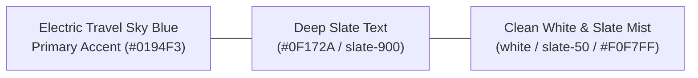

# TripGenie — Design System & Visual Direction (DESIGN.md)

> **Identity**: Nền tảng Lập kế hoạch Du lịch Thông minh Việt Nam & Cộng tác Thời gian thực.  
> **Aesthetic Philosophy**: **Modern Travel Tech & Clean Editorial** — Diện mạo du lịch hiện đại, dứt khoát, thoáng đãng, mang hơi thở công nghệ cao kết hợp tinh hoa trải nghiệm bản địa (lấy cảm hứng từ Traveloka, Airbnb, Google Arts & Culture, Canva).  
> **Source of Truth for Visuals**: Đồng bộ 100% với phong cách **Trang Chủ** (`frontend/src/app/page.tsx`), `frontend/src/app/globals.css` và `frontend/src/app/layout.tsx`.  
> **Governing Filter**: Kết hợp cùng `.agents/skills/antislop-ui/SKILL.md` để loại bỏ hoàn toàn "AI Slop".

---

## 1. Dials & Liveliness Settings (Tham số Antislop)

| Tham số | Giá trị | Ý nghĩa thực tế |
|---|---|---|
| **ENERGY** | `2` (Balanced) | Giao diện tươi sáng, tràn đầy năng lượng khám phá với sắc xanh **Electric Travel Sky Blue (`#0194F3`)**; tinh tế, sắc sảo, không dùng màu neon chói mắt. |
| **RHYTHM** | `2` (Harmonic) | Nhịp điệu bố cục đa dạng như trang chủ: Hero trực quan sắc nét $\to$ Horizontal Destination Track $\to$ Story Feature Blocks (Canva-style) $\to$ Asymmetric Mosaic Grid (Google Arts & Culture) $\to$ Collaborative Planning Mockup $\to$ Bản đồ tương tác. |
| **MOTION** | `1` (Subtle) | Chuyển động vi mô mượt mà (150ms–250ms, easing `cubic-bezier(0.22, 1, 0.36, 1)`): Zoom ảnh nhẹ 1.025–1.05 khi hover, trượt thanh cuộn điểm đến, popover nổi nhẹ. **Tuyệt đối không có chuyển động lặp vô tận (endless animation loops)**. Tôn trọng `prefers-reduced-motion`. |

---

## 2. Brand Identity & Visual Language (Phong cách Trang Chủ)

- **Tính cách thương hiệu**: Thông minh, dứt khoát, phóng khoáng, tin cậy, giàu chất bản địa.
- **Trải nghiệm cốt lõi**:
  - **Không rườm rà**: Loại bỏ phong cách phông chữ có chân (Serif/Playfair Display) cổ điển cũ; toàn bộ tiêu đề chuyển sang sans-serif đậm nét, dứt khoát, hiện đại.
  - **Khoảng thở làm khung kết cấu (`whitespace as structure`)**: Sử dụng nền trắng sạch (`bg-white`) xen kẽ các dải Slate cao cấp (`bg-slate-50`, `bg-[#F0F7FF]`, `bg-[#F8FAFC]`) tạo chiều sâu phân tầng rõ rệt.
  - **Hình ảnh chân thực**: Tôn vinh hình ảnh phong cảnh, ẩm thực và văn hóa thực tế với tỷ lệ chuẩn và hiệu ứng scrim chuyển màu tinh tế.
- **Nguyên tắc "The Litmus Test"**:
  > Giao diện TripGenie toát lên phong cách nền tảng du lịch thế hệ mới — chuẩn mực, sắc sảo, trực quan và tiện dụng, không bị nhầm lẫn với các dashboard quản lý khô khan.

---

## 3. Typography System (Đồng bộ 100% với Trang Chủ)

Toàn bộ hệ thống giao diện chuẩn hóa sử dụng **Inter** cho cả Tiêu đề và Nội dung, tối ưu hoàn hảo cho tiếng Việt có dấu:

| Vai trò | Phông chữ | Class Tailwind | Ứng dụng thực tế |
|---|---|---|---|
| **Headings (Tiêu đề)** | **Inter** | `font-sans font-black tracking-tight` hoặc `font-extrabold tracking-tight` | Tiêu đề Hero, Tiêu đề Section, Tên vùng đất, Tiêu đề bài viết. Nét chữ đậm đà, hiện đại, uy lực và dễ đọc. |
| **Body (Nội dung)** | **Inter** | `font-sans font-medium text-slate-600` | Đoạn văn mô tả, thông số lịch trình, giờ mở cửa, ghi chú. |
| **Eyebrow / Badges** | **Inter** | `text-xs font-bold uppercase tracking-wider` | Nhãn phân loại trên đầu section (`#0194F3`), thẻ danh mục. |
| **Monospace (Kỹ thuật)** | **Geist Mono** | `font-mono` | Tọa độ GPS, mã chuyến đi, mã đặt chỗ, số liệu chi phí. |

### Thang đo tỷ lệ (Type Scale) chuẩn Trang Chủ:
- `text-4xl sm:text-6xl md:text-7xl font-black tracking-tight leading-[1.12]`: Tiêu đề Hero chính.
- `text-3xl sm:text-4xl lg:text-5xl font-black text-slate-900 tracking-tight leading-tight`: Tiêu đề Section (`h2`).
- `text-2xl sm:text-3xl lg:text-4xl font-extrabold text-slate-900 tracking-tight leading-tight`: Tiêu đề khối tính năng (`h3`).
- `text-base sm:text-lg font-bold text-slate-900 leading-snug`: Tên thẻ địa điểm (`PlaceCard`), tên bài viết cộng đồng (`PostCard`).
- `text-sm sm:text-base text-slate-600 font-medium leading-relaxed`: Văn bản nội dung và mô tả.
- `text-xs font-bold uppercase tracking-wider`: Nhãn danh mục, tag trạng thái.

---

## 4. Color System (Bảng Màu Nhận Diện)

### 4.1 Bảng màu chủ đạo (Light Theme - Chuẩn Trang Chủ)
- **Primary Brand Color**: `#0194F3` (Electric Travel Sky Blue)  
  Màu xanh công nghệ du lịch đặc trưng của TripGenie. Dùng cho: Nút bấm chính (Primary CTA), đường dẫn nổi bật, icon chỉ hướng, tỷ lệ phần trăm tiến độ, thanh gạch chân chủ đề, viền focus.
- **Surface & Backgrounds**:
  - `bg-white`: Nền thẻ, nền trang chính sạch sẽ.
  - `bg-slate-50` / `bg-[#F0F7FF]` / `bg-[#F8FAFC]`: Nền section chuyển đổi mềm mại, không gây chói mắt.
- **Typography & Text Contrast**:
  - `text-slate-950` / `text-slate-900` (`#0F172A`): Tiêu đề chính, tương phản tối đa, sắc nét.
  - `text-slate-700` / `text-slate-600`: Nội dung mô tả, dễ đọc, không gây mỏi mắt.
  - `text-slate-400` / `text-muted-foreground`: Ghi chú phụ, thời gian đăng, placeholder.
- **Borders & Dividers**:
  - `border-slate-200/80` hoặc `border-slate-300`: Đường phân cách mảnh, tinh tế, giữ sự liền mạch.
- **Accent & Highlights**:
  - **Sunset Gold / Amber** (`#F59E0B`, `text-amber-500`): Dành riêng cho sao đánh giá (Rating stars), thời tiết nắng ấm, badge deal nổi bật.
  - **Soft Blue Badge**: `bg-blue-50 text-[#0194F3] border border-blue-200/80` cho các nhãn danh mục con nhộng.

---

## 5. Shape, Spacing & Elevation (Hình Khối & Chiều Sâu)

### 5.1 Bo góc (Border Radius Scale)
- **Thanh tìm kiếm & Badges**: `rounded-full` — Thân thiện, mượt mà, tạo cảm giác mời gọi tương tác.
- **Cards thông thường & Modals**: `rounded-2xl` (16px) — Bo tròn vừa vặn, chuẩn mực hiện đại.
- **Khối tính năng lớn & Story Blocks**: `rounded-3xl` (24px) — Tạo khung chứa vững chãi, ôm trọn nội dung.
- **Buttons & Input fields**: `rounded-xl` (12px) hoặc `rounded-full` tùy theo cấp bậc thị giác.

### 5.2 Shadows & Elevation (Độ nổi)
- **Thẻ thông thường khi đứng yên**: `border border-slate-200/80 shadow-xs` hoặc `shadow-sm`.
- **Thẻ khi hover**: 
  - Ảnh zoom nhẹ 1.025–1.05 (`transition-transform duration-500 ease-out`).
  - Viền chuyển sang xanh nhẹ hoặc xám đậm hơn: `hover:border-slate-300` / `hover:border-[#0194F3]/40`.
  - Độ bóng nâng lên: `hover:shadow-xl` hoặc `hover:shadow-2xl`. Thẻ giữ nguyên trục toạ độ, không rung lắc.
- **Floating Modals & Dropdowns**: `shadow-2xl border border-slate-200/90 backdrop-blur-md bg-white/95`.

---

## 6. Component Rules (Quy Chuẩn Thành Phần Giao Diện)

### 6.1 Section Headers
- Cấu trúc 3 tầng chuẩn trang chủ:
  1. **Eyebrow**: `text-xs font-bold uppercase tracking-wider text-[#0194F3]`.
  2. **Title (`h2`)**: `text-3xl sm:text-4xl lg:text-5xl font-black text-slate-900 tracking-tight leading-tight`.
  3. **Description**: `text-slate-600 text-sm sm:text-base max-w-2xl leading-relaxed`.

### 6.2 Buttons & Interactions
- Primary Button: `bg-[#0194F3] hover:bg-[#0082d6] text-white font-bold rounded-xl shadow-xs transition-all active:scale-[0.98]`.
- Secondary / Outline Button: `border border-slate-300 bg-white hover:bg-slate-50 text-slate-800 font-semibold rounded-xl shadow-xs`.
- Đảm bảo **Functional Completeness (C-2)**: Mọi nút bấm hiển thị đều phải gắn liền với hành vi thật hoặc mở modal tương ứng.

### 6.3 Empty, Loading & Error States (Quy tắc 4 Trạng thái)
- **Loading State**: Sử dụng Skeleton UI tương đồng hình học với component thực tế, không dùng spinner trơ trọi.
- **Empty State**: Nêu rõ lý do trống và cung cấp đúng **1 nút hành động tích cực** để lấp đầy dữ liệu.
- **Error State**: Nêu rõ thông điệp và có nút `[Thử lại]`.

---

## 7. Anti-Slop Safeguards (Bộ Lọc Chống Slop)

1. ❌ **Không dùng gradient AI tím-xanh rập khuôn**: Chỉ dùng các dải chuyển màu xanh nhạt hoặc slate sang trọng (`from-[#F0F7FF] via-[#F8FAFC] to-[#F1F5F9]`).
2. ❌ **Không emoji trang trí trong nút/tiêu đề**: Dùng icon SVG dứt khoát từ Lucide.
3. ❌ **Không số liệu ảo (No fake stats/metrics)**: Mọi con số bài đăng, lượt nhân bản, đánh giá đều lấy từ cơ sở dữ liệu thật.
4. ❌ **Không endless pulse loops**: Không nhấp nháy đèn trạng thái vô tận gây phân tâm.
5. ❌ **Không bento grid hỗn loạn vô nghĩa**: Bố cục phải bám sát câu chuyện nội dung thực tế của du lịch.
